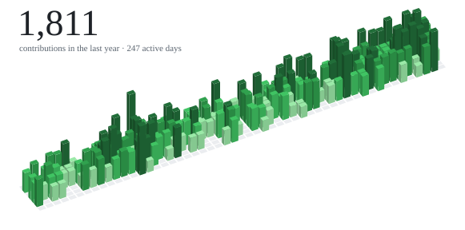

<picture>
  <source media="(prefers-color-scheme: dark)" srcset="https://raw.githubusercontent.com/EliaTogni/EliaTogni/output/city-dark.svg">
  
</picture>

**Elia Togni** — Full-stack developer & AI specialist · Brescia\
Kotlin · Compose Multiplatform · Ktor · Flutter\
[eliatogni.github.io](https://eliatogni.github.io)
